# Kịch bản thuyết trình · Dự đoán khách hàng rời bỏ dịch vụ viễn thông

**Môn học** · Kho dữ liệu và kỹ thuật khai phá  
**Nhóm** · [Tên hoặc số nhóm]  
**Giảng viên hướng dẫn** · [Họ tên]  
**Thời lượng** · 15 phút, gồm 2 phút 10 giây demo

Dàn bài theo [bộ slide mẫu](../learn/slide.pdf). Slide 1–2 mở đầu, 3–4 giới thiệu dữ liệu, 5–7 trình bày tiền xử lý, 8–9 giới thiệu mô hình và cách huấn luyện, 10–12 phân tích kết quả, 13–14 trình bày vận hành và demo, 15 tổng kết và hỏi đáp. Các ảnh chụp Streamlit nằm trong [thư mục ảnh](../images/).

## Slide 1 · Dự đoán khách hàng rời bỏ dịch vụ viễn thông

**Thời lượng** · 0:40  
**Trên slide** · Tên đề tài, môn học, nhóm và giảng viên. Bên dưới đặt câu hỏi “Đội chăm sóc nên xem hồ sơ nào trước?”

**Lời thuyết trình**

> Em xin chào thầy cô và các bạn. Nhóm em là [tên nhóm]. Hôm nay nhóm trình bày đề tài dự đoán khách hàng rời bỏ dịch vụ viễn thông. Giả sử đội chăm sóc chỉ có thể xem xét một phần danh sách khách hàng. Họ nên bắt đầu từ đâu? Nhóm dùng dữ liệu IBM Telco để tìm các nhóm có tỷ lệ rời bỏ cao, kiểm thử khả năng phát hiện churn và minh họa cách xếp ưu tiên bằng dashboard.

**Chuyển ý** · “Trước khi vào dữ liệu, nhóm em xin giới thiệu phần việc của các thành viên.”

## Slide 2 · Thành viên nhóm và phân công

**Thời lượng** · 0:25  
**Trên slide** · Bảng họ tên, mã sinh viên và nhiệm vụ. Điền theo phân công thực tế trước buổi báo cáo.

| Họ tên | Mã sinh viên | Nhiệm vụ thực tế |
|---|---|---|
| [Họ tên] | [Mã SV] | [Làm sạch và mã hóa dữ liệu] |
| [Họ tên] | [Mã SV] | [Phân tích dữ liệu và kiểm tra đặc trưng] |
| [Họ tên] | [Mã SV] | [Huấn luyện và đánh giá mô hình] |
| [Họ tên] | [Mã SV] | [Dashboard, demo và tổng hợp báo cáo] |

**Lời thuyết trình**

> Nhóm thực hiện bốn phần việc gồm chuẩn bị dữ liệu, phân tích đặc trưng, xây dựng mô hình và triển khai demo. [Giới thiệu ngắn tên từng thành viên và nhiệm vụ tương ứng.]

**Chuyển ý** · “Nhóm bắt đầu bằng việc kiểm tra chất lượng dữ liệu IBM Telco.”

## Slide 3 · Nguồn dữ liệu và chất lượng hồ sơ

**Thời lượng** · 0:55  
**Trên slide** · Đặt ba số 7.043, 7.032 và 26,58% cạnh ảnh bảng chất lượng dữ liệu.

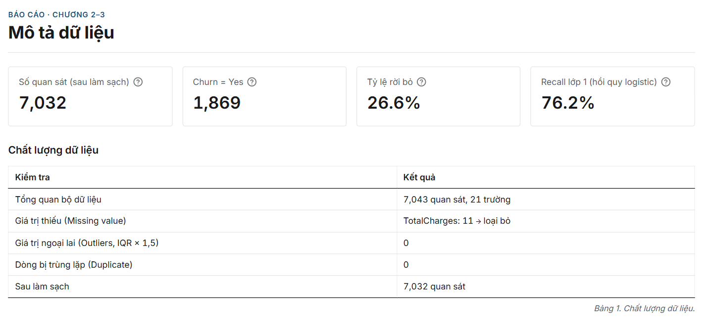

**Lời thuyết trình**

> Bộ IBM Telco Customer Churn ban đầu có 7.043 hồ sơ và 21 trường. Mỗi dòng là một khách hàng. Khi làm sạch, chương trình cắt khoảng trắng, chuyển các trường phí sang kiểu số và kiểm tra nhãn, dòng trùng và mã khách trùng. Có 11 hồ sơ thiếu TotalCharges được loại, nên còn 7.032 hồ sơ hợp lệ.
>
> Sau làm sạch, 5.163 khách ở lại và 1.869 khách rời bỏ, tương đương 26,58% churn. Đây là mức chênh lệch giữa hai lớp trước khi chia tập.

**Đối chiếu** · [Mã làm sạch](../../src/data.py) · [Số liệu chất lượng](../../outputs/metrics.json)  
**Chuyển ý** · “Tiếp theo, nhóm xem các trường dữ liệu chính và cách tỷ lệ churn thay đổi theo từng nhóm.”

## Slide 4 · Thuộc tính dữ liệu và churn theo nhóm

**Thời lượng** · 1:00  
**Trên slide** · Bảng thuộc tính bên trái, biểu đồ tỷ lệ rời bỏ theo hợp đồng bên phải.

| Trường | Ý nghĩa |
|---|---|
| customerID, Churn | Mã hồ sơ và nhãn thực tế Yes/No |
| tenure, Contract | Số tháng sử dụng và loại hợp đồng |
| InternetService, TechSupport | Loại Internet và tình trạng sử dụng hỗ trợ kỹ thuật |
| MonthlyCharges, TotalCharges | Phí hàng tháng và tổng phí tích lũy |
| PaymentMethod | Phương thức thanh toán |

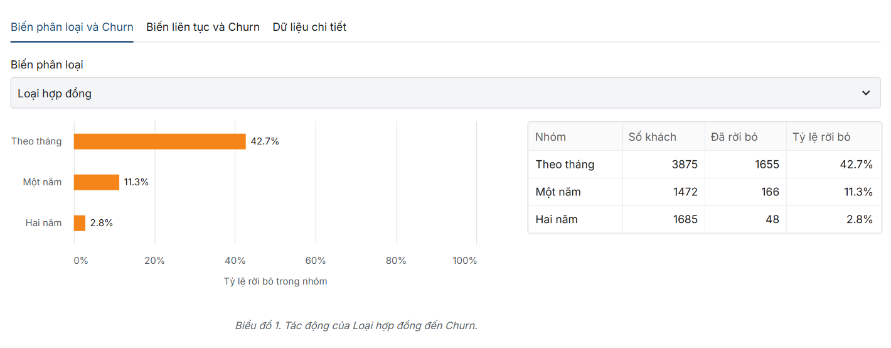

**Lời thuyết trình**

> Mỗi hồ sơ mô tả thời gian sử dụng, hợp đồng, dịch vụ và thanh toán. Nhãn Churn cho biết khách đã rời bỏ hay ở lại. Để đọc biểu đồ, lấy số khách đã rời bỏ chia cho tổng khách trong từng nhóm. Ví dụ, hợp đồng theo tháng có 1.655 trên 3.875 khách rời bỏ, tức 42,7%. Hai nhóm hợp đồng một năm và hai năm lần lượt có tỷ lệ 11,3% và 2,8%.
>
> Khi đổi sang loại Internet, cáp quang có tỷ lệ 41,9%, DSL 19,0% và nhóm không dùng Internet 7,4%. Đây là các tỷ lệ quan sát trong bộ dữ liệu.

**Đối chiếu** · [Cách tính tỷ lệ theo nhóm](../../src/dashboard.py) · [Bảng thống kê nhóm](../../outputs/tables/eda_churn_by_category.csv)  
**Chuyển ý** · “Để đưa các trường này vào mô hình, nhóm mã hóa dữ liệu và giữ riêng một tập kiểm thử.”

## Slide 5 · Mã hóa, khảo sát đặc trưng và chia tập

**Thời lượng** · 1:05  
**Trên slide** · Minh họa mã hóa một trường phân loại, ba kết quả khảo sát ngắn và bảng chia tập phân tầng 80/20.

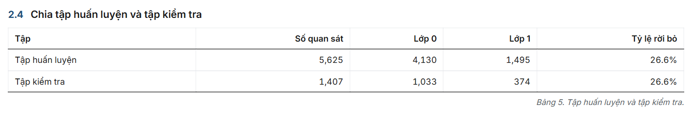

| Khảo sát | Kết quả minh họa |
|---|---|
| ANOVA F | tenure đứng đầu trong ba biến số, F ≈ 1.007,51 |
| Chi-square | Chỉ báo hợp đồng theo tháng đứng đầu trong các biến 0/1, χ² ≈ 516,71 |
| Mutual Information | Hợp đồng theo tháng ≈ 0,092 và tenure ≈ 0,086 |

**Lời thuyết trình**

> Nhóm mã hóa Churn thành 1 nếu rời bỏ và 0 nếu ở lại, rồi tách nhãn và mã khách khỏi đầu vào. Với biến hợp đồng, one-hot encoding tạo các cột chỉ báo, chẳng hạn cột hợp đồng theo tháng bằng 1 khi khách thuộc nhóm đó.
>
> ANOVA F, Chi-square và Mutual Information giúp khảo sát từng đặc trưng. Hợp đồng theo tháng và thời gian sử dụng nổi bật qua các kết quả này. Bộ biến của từng mô hình được khai báo trong cấu hình dự án.
>
> Nhóm chia phân tầng theo Churn với seed 42. Tập huấn luyện có 5.625 hồ sơ, gồm 1.495 khách rời bỏ. Tập kiểm thử có 1.407 hồ sơ, gồm 374 khách rời bỏ, và được dùng chung để đánh giá ba cấu hình phân loại.

**Đối chiếu** · [Mã hóa và bộ biến](../../src/data.py) · [Khảo sát đặc trưng](../../src/feature_tests.py) · [Cách chia tập](../../src/models.py)  
**Chuyển ý** · “Ở tập huấn luyện, lớp rời bỏ vẫn ít hơn nhiều. Pipeline Logistic xử lý bước này bằng SMOTE.”

## Slide 6 · Cân bằng tập huấn luyện bằng SMOTE

**Thời lượng** · 0:55  
**Trên slide** · Đặt biểu đồ trước/sau SMOTE cạnh bảng số mẫu. Chỉ vào dòng kiểm thử giữ nguyên.

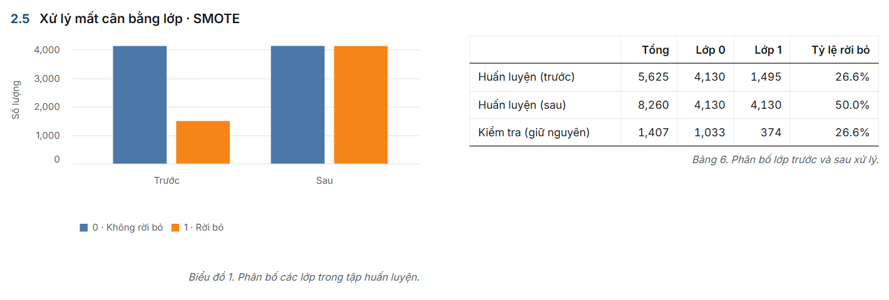

**Lời thuyết trình**

> Trước SMOTE, tập huấn luyện có 4.130 khách ở lại và 1.495 khách rời bỏ. SMOTE nội suy giữa các điểm lân cận thuộc lớp rời bỏ để sinh thêm 2.635 mẫu, đưa hai lớp lên 4.130 mẫu mỗi lớp. Tập kiểm thử giữ nguyên 1.407 hồ sơ.
>
> Trong báo cáo, bước này thuộc pipeline Logistic. Khi kiểm định chéo, SMOTE chỉ chạy trên phần huấn luyện của từng lượt để phần xác thực giữ riêng.

**Đối chiếu** · [Pipeline Logistic](../../src/models.py) · [Bản xem trước trên Streamlit](../../src/retrain.py)  
**Chuyển ý** · “Sau cân bằng, Logistic đưa các đặc trưng về thang đo chuẩn.”

## Slide 7 · Chuẩn hóa bằng StandardScaler

**Thời lượng** · 0:45  
**Trên slide** · Đặt công thức z = (x − μ) / σ cạnh bảng trung bình và độ lệch chuẩn trước/sau.

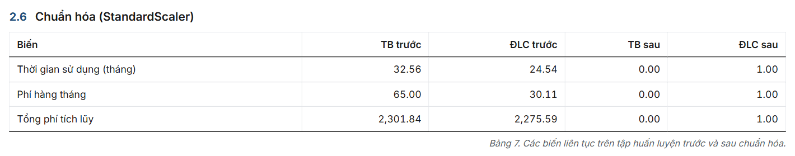

**Lời thuyết trình**

> Thời gian sử dụng tính bằng tháng, còn phí hàng tháng và tổng phí có thang đo khác. StandardScaler trừ trung bình và chia cho độ lệch chuẩn. Bảng minh họa ba biến liên tục trên tập huấn luyện gốc, với trung bình sau chuẩn hóa gần 0 và độ lệch chuẩn bằng 1.
>
> Trong pipeline Logistic của báo cáo, scaler được khớp sau SMOTE trên phần huấn luyện. Khi dự đoán, hệ thống dùng lại các tham số đó để biến đổi đầu vào.

**Đối chiếu** · [Minh họa chuẩn hóa](../../src/retrain.py) · [Thứ tự pipeline Logistic](../../src/models.py)  
**Chuyển ý** · “Với dữ liệu đã chuẩn bị, nhóm áp dụng hai cách phân loại.”

## Slide 8 · Cây quyết định và hồi quy Logistic

**Thời lượng** · 1:05  
**Trên slide** · Đặt hai khối ngang. Khối cây chỉ vào nút gốc. Khối Logistic mô tả điểm rủi ro và ngưỡng 0,5.

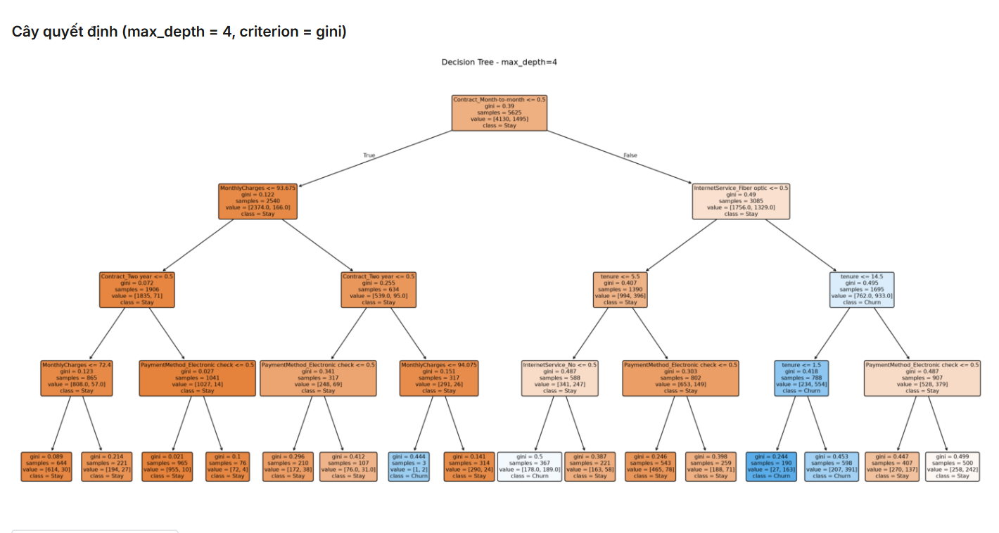

**Lời thuyết trình**

> Cây quyết định dùng các câu hỏi liên tiếp để chia hồ sơ. Trong mô hình của nhóm, nút gốc kiểm tra chỉ báo hợp đồng theo tháng. Cây dùng 7 đặc trưng, tiêu chí Gini và độ sâu tối đa 4.
>
> Logistic kết hợp các đặc trưng thành điểm rủi ro từ 0 đến 1. Tại ngưỡng 0,5, hệ thống xếp hồ sơ vào lớp rời bỏ nếu điểm đạt ngưỡng. Nhóm kiểm thử hai cấu hình Logistic. Bản đầy đủ có 23 đặc trưng sau mã hóa, còn bản điều chỉnh có 16 đặc trưng từ 12 trường gốc.

**Đối chiếu** · [Cấu hình và thuật toán](../../src/models.py) · [Quy tắc của cây](../../outputs/tables/decision_tree_rules.txt)  
**Chuyển ý** · “Sau đây là cách nhóm huấn luyện và thiết lập phép so sánh.”

## Slide 9 · Huấn luyện và độ đo đánh giá

**Thời lượng** · 1:00  
**Trên slide** · Cột trái mô tả cách huấn luyện. Cột phải đánh dấu Recall và Precision của lớp rời bỏ.

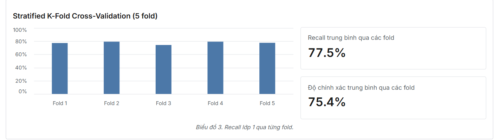

**Lời thuyết trình**

> Hai cấu hình Logistic được kiểm định chéo phân tầng 5 lượt trên tập huấn luyện, sau đó được khớp lại với toàn bộ tập huấn luyện. Ảnh cho thấy Recall trung bình của Logistic sau điều chỉnh qua năm lượt là khoảng 77,5%. Ba cấu hình được so sánh trên cùng tập kiểm thử giữ riêng.
>
> Recall cho biết mô hình phát hiện được bao nhiêu trong số khách thực sự rời bỏ. Precision cho biết trong số khách được cảnh báo có bao nhiêu người thực sự rời bỏ. Accuracy tính tỷ lệ đúng trên toàn tập, F1 điều hòa Precision và Recall, còn ROC-AUC đo khả năng phân biệt hai lớp qua các ngưỡng.

**Đối chiếu** · [Huấn luyện và kiểm định chéo](../../src/models.py) · [Mã tính các độ đo](../../src/evaluation.py)  
**Chuyển ý** · “Khi áp dụng vào cùng 1.407 hồ sơ kiểm thử, mỗi cấu hình nổi bật ở những chỉ số khác nhau.”

## Slide 10 · Đánh giá và so sánh mô hình

**Thời lượng** · 1:10  
**Trên slide** · Biểu đồ Recall và bảng so sánh. Đánh dấu giá trị dẫn đầu theo từng cột.

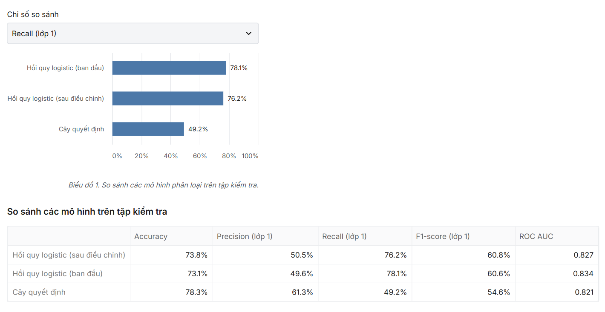

| Mô hình | Accuracy | Precision | Recall | F1 | ROC-AUC |
|---|---:|---:|---:|---:|---:|
| Cây quyết định | **78,3%** | **61,3%** | 49,2% | 54,6% | 0,821 |
| Logistic đầy đủ | 73,1% | 49,6% | **78,1%** | 60,6% | **0,834** |
| Logistic điều chỉnh | 73,8% | 50,5% | 76,2% | **60,8%** | 0,827 |

**Lời thuyết trình**

> Cây quyết định có Accuracy và Precision cao nhất, đồng thời phát hiện khoảng một nửa số khách thực sự rời bỏ. Logistic đầy đủ có Recall 78,1% và ROC-AUC 0,834. Bản điều chỉnh đạt Recall 76,2% và F1 60,8%, gần với bản đầy đủ về F1. Đây là bản dashboard dùng mặc định, với đầu vào gồm 12 trường gốc.

**Đối chiếu** · [Kết quả kiểm thử lưu trong dự án](../../outputs/metrics.json)  
**Chuyển ý** · “Ma trận của bản điều chỉnh cho thấy cụ thể số khách phát hiện đúng, bỏ sót và cảnh báo nhầm.”

## Slide 11 · Phân tích ma trận nhầm lẫn

**Thời lượng** · 1:10  
**Trên slide** · Chỉ hàng thực tế, cột dự đoán, sau đó nhấn vào 285 ca phát hiện đúng, 89 ca bỏ sót và 279 cảnh báo nhầm.

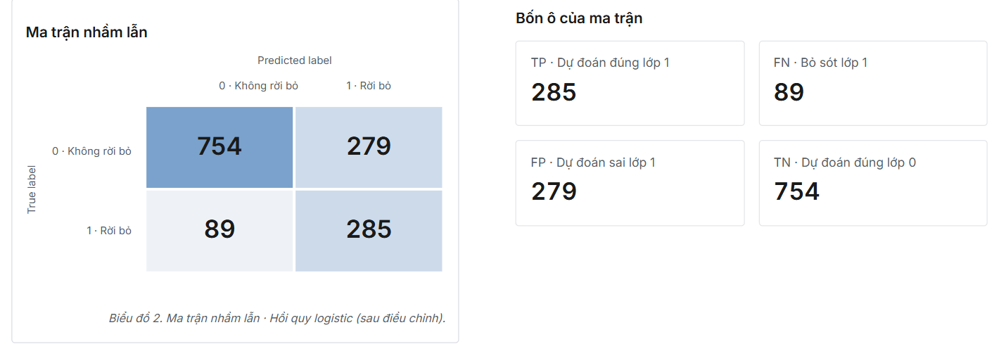

**Lời thuyết trình**

> Hàng là trạng thái thực tế, cột là nhãn dự đoán. Ở hàng khách rời bỏ, có 285 ca phát hiện đúng và 89 ca bỏ sót. Có 374 khách thực sự rời bỏ, nên Recall bằng 285 chia 374, tức 76,2%.
>
> Ở cột dự đoán rời bỏ, mô hình cảnh báo 564 khách. Trong đó có 285 khách thực sự rời bỏ và 279 khách thực tế ở lại. Precision bằng 285 chia 564, tức 50,5%. Ô còn lại là 754 dự đoán đúng khách ở lại. Khi sử dụng hệ thống, ca bỏ sót khiến một số hồ sơ cần chú ý có thể bị bỏ qua, còn cảnh báo nhầm làm tăng khối lượng rà soát.

**Đối chiếu** · [Báo cáo phân loại](../../outputs/tables/classification_report_logistic_selected.txt)  
**Chuyển ý** · “Sau khi biết mô hình sai ở đâu, nhóm xem các đặc trưng liên hệ với điểm rủi ro theo chiều nào.”

## Slide 12 · Diễn giải hệ số Logistic

**Thời lượng** · 1:05  
**Trên slide** · Dùng biểu đồ hệ số của bản điều chỉnh. Chỉ hai thanh dương và hai thanh âm tiêu biểu.

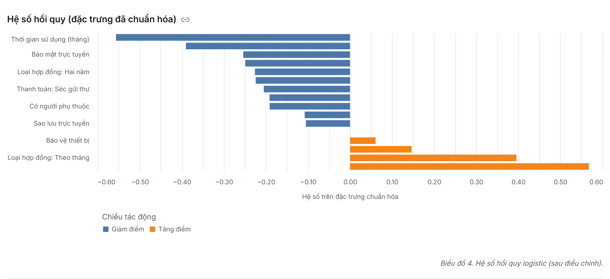

| Đặc trưng đã chuẩn hóa | Hệ số |
|---|---:|
| Internet cáp quang | +0,568 |
| Hợp đồng theo tháng | +0,396 |
| Thời gian sử dụng | −0,557 |
| Không dùng Internet | −0,390 |

**Lời thuyết trình**

> Biểu đồ biểu diễn hệ số Logistic sau chuẩn hóa. Khi giữ các đặc trưng còn lại cố định, hệ số dương làm tăng log-odds rời bỏ mà mô hình dự đoán, còn hệ số âm làm giảm. Chẳng hạn, chỉ báo cáp quang và hợp đồng theo tháng có hệ số dương, còn thời gian sử dụng có hệ số âm.
>
> Đây là cách đọc hành vi của mô hình. Để đánh giá tác động của một thay đổi như chuyển loại hợp đồng, cần thêm bằng chứng về những yếu tố khác có thể ảnh hưởng đến churn.

**Đối chiếu** · [Bảng hệ số Logistic điều chỉnh](../../outputs/tables/logistic_selected_coefficients.csv)  
**Chuyển ý** · “Khi có thêm hồ sơ đã biết kết quả Churn, dashboard hỗ trợ tạo một lần huấn luyện mới.”

## Slide 13 · Cập nhật dữ liệu và huấn luyện theo đợt

**Thời lượng** · 0:55  
**Trên slide** · Sơ đồ Dữ liệu → Tiền xử lý → Huấn luyện → So sánh → Chọn mô hình cho Dự đoán.

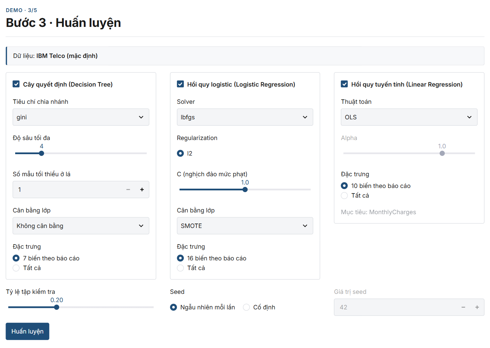

**Lời thuyết trình**

> Người dùng có thể bổ sung CSV đã có nhãn Churn. Khi trùng mã khách giữa hai nguồn, bản ghi mới được ưu tiên. Tiếp theo, người dùng kiểm tra dữ liệu, đặt tỷ lệ kiểm thử, chọn cấu hình và bấm Huấn luyện.
>
> Hệ thống lưu kết quả và mô hình theo từng lần chạy. Trên trang So sánh, người dùng có thể đối chiếu Recall hoặc F1 rồi chọn mô hình cho trang Dự đoán. Khi so ảnh hưởng của một cấu hình, giữ cùng dữ liệu, tỷ lệ chia và seed.

**Đối chiếu** · [Gộp dữ liệu, lưu lần chạy và chọn mô hình](../../src/retrain.py)  
**Chuyển ý** · “Để minh họa đầu ra cuối cùng, nhóm sẽ chấm điểm ba hồ sơ mẫu.”

## Slide 14 · Demo hệ thống Streamlit

**Thời lượng** · 2:10  
**Trên slide** · Ba khối chức năng gồm xem dữ liệu, xem kết quả kiểm thử và chấm điểm hồ sơ. Đặt ảnh kết quả dự đoán bên dưới.

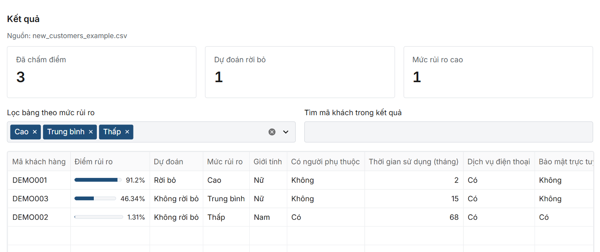

**Chuẩn bị** · Từ thư mục gốc, chạy `streamlit run app.py`. Mở [dashboard cục bộ](http://127.0.0.1:8501) và kiểm tra trang Dự đoán đang dùng **Hồi quy logistic (sau điều chỉnh)** mặc định để số điểm khớp với ảnh.

| Thao tác | Lời nói khi thao tác |
|---|---|
| **Mô tả dữ liệu** → **Chất lượng dữ liệu** | “Sau khi loại 11 hồ sơ thiếu tổng phí, nhóm còn 7.032 hồ sơ.” |
| **Kỹ thuật khai phá** → chọn **Recall (lớp 1)** và **Hồi quy logistic (sau điều chỉnh)** → **Báo cáo phân loại** | “Ở hàng rời bỏ, có 285 ca phát hiện đúng và 89 ca bỏ sót, tương ứng Recall 76,2%.” |
| **5. Dự đoán** → **Hàng loạt qua CSV** → **Chạy thử 3 khách hàng mẫu** | “Bảng xếp hồ sơ theo điểm từ cao xuống thấp. DEMO001 có điểm 0,9120, nên đứng đầu danh sách.” |
| Đối chiếu **DEMO003** và **DEMO002** | “Cả hai nằm dưới ngưỡng phân loại 0,5. DEMO003 có điểm 0,4634 và rủi ro trung bình, còn DEMO002 có điểm 0,0131 và rủi ro thấp.” |

**Lời chốt demo**

> Đội chăm sóc có thể xem DEMO001 trước, rồi dùng bộ lọc hoặc tìm mã khách để rà từng hồ sơ. Các điểm dùng để xếp ưu tiên và cần được hiệu chuẩn trước khi diễn giải như xác suất rời bỏ thực tế.

**Đối chiếu** · [Ứng dụng Streamlit](../../app.py) · [CSV ba khách hàng mẫu](../../data/new_customers_example.csv)  
**Chuyển ý** · “Nhóm xin tổng kết ba kết quả chính và chuyển sang phần hỏi đáp.”

## Slide 15 · Tổng kết, cảm ơn và hỏi đáp

**Thời lượng** · 0:40  
**Trên slide** · Ba ý ngắn gồm nhóm có tỷ lệ rời bỏ cao, kết quả phát hiện và cách ứng dụng.

**Lời thuyết trình**

> Từ dữ liệu IBM, nhóm ghi nhận 42,7% khách hợp đồng theo tháng đã rời bỏ. Trên tập kiểm thử, Logistic điều chỉnh phát hiện được 285 trong 374 khách rời bỏ và tạo 279 cảnh báo nhầm. Dashboard dùng điểm để sắp thứ tự hồ sơ cho đội chăm sóc.
>
> Trước khi đưa vào vận hành, cần đánh giá trên dữ liệu mới theo thời gian và chọn ngưỡng phù hợp với nguồn lực rà soát. Nhóm em cảm ơn thầy cô và các bạn đã lắng nghe. Nhóm xin mời thầy cô và các bạn đặt câu hỏi.

## Phần dự phòng · Hồi quy tuyến tính về phí hàng tháng

OLS trả lời câu hỏi bổ sung về **MonthlyCharges**. Đầu vào loại TotalCharges vì tổng phí tích lũy chứa thông tin liên quan đến khoản phí cần ước tính.

| Cấu hình OLS | R² kiểm thử | MAE kiểm thử |
|---|---:|---:|
| Đầy đủ sau khi bỏ các cột chỉ báo tham chiếu | 0,999 | 0,78 |
| 10 biến chọn lọc | 0,969 | 3,53 |

Trong bản chọn lọc, hệ số MultipleLines xấp xỉ 7,77. Khi giữ các biến khác cố định, khách có chỉ báo nhiều đường dây được ước tính trả cao hơn khoảng 7,77 đơn vị phí. Có thể mở **Kỹ thuật khai phá → Diễn giải kết quả → Hồi quy tuyến tính (MonthlyCharges) và thống kê** để đối chiếu. [Chỉ số kiểm thử](../../outputs/metrics.json) · [Bảng hệ số](../../outputs/tables/ols_coefficients_selected.csv)

## Phần dự phòng · Demo huấn luyện lại

1. Mở **1. Dữ liệu**. Dùng bộ IBM có sẵn hoặc bổ sung CSV cùng cấu trúc, có nhãn Churn.
2. Mở **2. Tiền xử lý**. Giữ tập kiểm tra 20%, seed 42 và SMOTE nếu muốn minh họa các con số ở slide 5–6.
3. Mở **3. Huấn luyện**, chọn Logistic, chọn seed **Cố định**, nhập 42 rồi bấm **Huấn luyện**.
4. Mở **4. So sánh** và đọc Recall hoặc F1. Để minh họa đổi mô hình, chọn lần chạy và mô hình, sau đó bấm **Dùng mô hình đã chọn**.
5. Mở **5. Dự đoán**. Kiểm tra tên mô hình đang dùng và chạy lại hồ sơ mẫu. Điểm có thể thay đổi theo mô hình vừa chọn.

## Câu hỏi phản biện dự kiến

| Câu hỏi | Gợi ý trả lời |
|---|---|
| Vì sao cần Recall khi đã có Accuracy? | Lớp ở lại chiếm 73,42% dữ liệu sau làm sạch. Recall đo trực tiếp tỷ lệ phát hiện trong số khách thực sự rời bỏ. |
| Vì sao SMOTE chạy sau khi chia tập? | Nếu chạy trước khi chia, quá trình sinh mẫu có thể sử dụng thông tin từ những hồ sơ sẽ đưa vào đánh giá. |
| Vì sao dashboard mặc định dùng Logistic điều chỉnh? | Bản điều chỉnh dùng 12 trường gốc, đạt Recall 76,2% và F1 60,8%. Bản đầy đủ đạt Recall 78,1% trên cùng tập kiểm thử nếu ưu tiên phát hiện thêm khách rời bỏ. |
| Hệ số dương của hợp đồng theo tháng nói lên điều gì? | Khi giữ các biến mô hình còn lại cố định, chỉ báo này làm tăng log-odds dự đoán. Đánh giá tác động của thay đổi hợp đồng cần thêm bằng chứng. |
| Điểm 0,9120 có phải xác suất rời bỏ thực tế 91,2%? | Đây là điểm dùng để xếp ưu tiên hồ sơ. Cần kiểm tra và hiệu chuẩn trên dữ liệu phù hợp trước khi diễn giải thành xác suất thực tế. |
| Vì sao Recall kiểm thử và Recall kiểm định chéo khác nhau? | 76,2% tính trên tập kiểm thử giữ riêng, còn 77,5% là trung bình của năm lượt xác thực trong tập huấn luyện. |
