# Kịch bản thuyết trình dự đoán khách hàng rời bỏ dịch vụ viễn thông

**Quy mô:** 15 slide, khoảng 16–18 phút, gồm khoảng 2 phút demo.

**Thông tin cần điền:** tên nhóm, giảng viên, họ tên và mã sinh viên của năm thành viên.

Kịch bản dựa trên [tài liệu nội dung chi tiết](noi-dung-slide-chi-tiet-theo-codebase.md), mã nguồn và kết quả đang lưu trong dự án. Mỗi slide có nội dung để chiếu, ảnh/bố cục và lời thoại. Chỉ đưa phần “Nội dung để chiếu” cùng hình minh họa lên màn hình; lời thoại và ghi chú dùng cho người trình bày.

Các ảnh bên dưới là ảnh đã có trong `slide/images/`, được đối chiếu trực quan với nội dung. Slide mở đầu, phân công và kết luận dùng bố cục chữ hoặc sơ đồ, không cần thêm ảnh trang trí. Những số trong ảnh dự đoán là kết quả của lần chụp, có thể thay đổi nếu kích hoạt mô hình khác.

## Slide 1 · Giới thiệu đề tài

**Thời lượng:** khoảng 40 giây.

### Nội dung để chiếu

**DỰ ĐOÁN KHÁCH HÀNG RỜI BỎ DỊCH VỤ VIỄN THÔNG**

- Bài toán phân loại nhị phân trên IBM Telco Customer Churn.
- Dự đoán nhãn rời bỏ và điểm nguy cơ.
- Hỗ trợ xác định khách hàng cần ưu tiên chăm sóc.

**Nhóm:** [Tên nhóm] · **Giảng viên:** [Họ tên] · **Môn học:** [Tên môn]

### Ảnh và bố cục

Đặt tên đề tài ở trung tâm. Phía dưới là sơ đồ ba khối, dựng trực tiếp bằng hình chữ nhật và mũi tên:

**Hồ sơ khách hàng → Mô hình phân loại → Điểm nguy cơ và nhãn Churn**

Không dùng hình hoặc tên thuật toán CatBoost từ slide mẫu về tiểu đường.

### Lời thoại

> Em xin chào thầy cô và các bạn. Nhóm em xin trình bày đề tài dự đoán khách hàng rời bỏ dịch vụ viễn thông. Bài toán xuất phát từ nhu cầu xác định những khách hàng cần được ưu tiên xem xét và chăm sóc.
>
> Nhóm sử dụng dữ liệu IBM Telco để xây dựng mô hình phân loại, sau đó triển khai ứng dụng cho phép nhập một hồ sơ hoặc tải danh sách khách hàng. Kết quả gồm nhãn dự đoán và điểm nguy cơ, giúp người dùng sắp xếp thứ tự rà soát hồ sơ.

**Chuyển ý:** “Trước hết, nhóm em xin giới thiệu phân công thực hiện.”

## Slide 2 · Thành viên và phân công

**Thời lượng:** khoảng 30 giây.

### Nội dung để chiếu

| Thành viên | Nhiệm vụ |
|---|---|
| [Họ tên 1 · Mã SV] | Dữ liệu, làm sạch, mã hóa và phân tích dữ liệu |
| [Họ tên 2 · Mã SV] | Decision Tree và Logistic Regression |
| [Họ tên 3 · Mã SV] | Linear Regression và tổng hợp so sánh kết quả |
| [Họ tên 4 · Mã SV] | Giao diện ứng dụng Streamlit |
| [Họ tên 5 · Mã SV] | Dữ liệu mới, huấn luyện lại và tích hợp demo |

### Ảnh và bố cục

Dùng bảng năm dòng, không cần ảnh. Điền đúng thông tin nhóm trước khi trình chiếu.

### Lời thoại

> Nhóm có năm thành viên, phụ trách lần lượt các phần dữ liệu và tiền xử lý; hai mô hình phân loại; hồi quy tuyến tính và so sánh kết quả; giao diện Streamlit; cuối cùng là dữ liệu mới, huấn luyện lại và tích hợp demo.
>
> Các phần được kết nối thành quy trình từ dữ liệu đầu vào đến đánh giá mô hình và dự đoán trên ứng dụng.

**Chuyển ý:** “Bước đầu tiên của quy trình là xác định và kiểm tra bộ dữ liệu.”

## Slide 3 · Nguồn dữ liệu và chất lượng hồ sơ

**Thời lượng:** khoảng 1 phút.

### Nội dung để chiếu

**IBM TELCO CUSTOMER CHURN**

- Ban đầu: **7.043 khách hàng, 21 cột**.
- Mỗi dòng là một hồ sơ; nhãn `Churn` nhận `Yes/No`.
- Xử lý khoảng trắng, sai kiểu số, giá trị thiếu và mã khách trùng.
- Loại **11 dòng thiếu TotalCharges**, còn **7.032 hồ sơ**.
- Bộ dữ liệu hiện tại có **0 dòng trùng hoàn toàn**, **0 mã khách trùng**.

Nguồn: [IBM Telco Customer Churn](https://github.com/IBM/telco-customer-churn-on-icp4d/blob/master/data/Telco-Customer-Churn.csv).

### Ảnh và bố cục

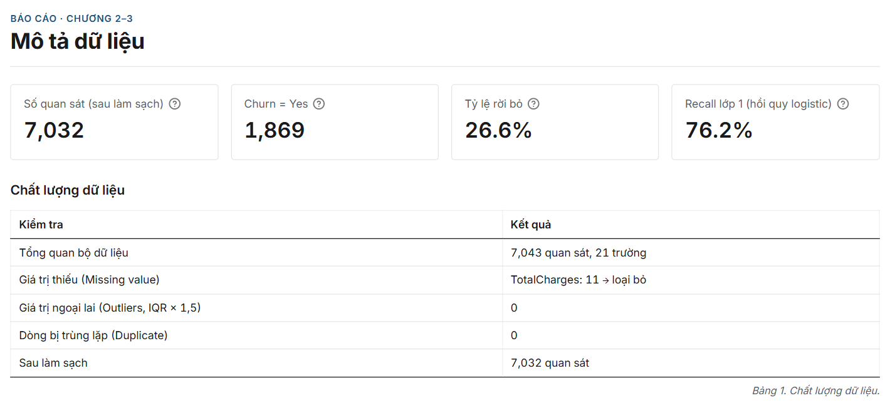

Đặt ảnh bên phải, các số 7.043 → 7.032 ở bên trái. Nếu cần phóng to, cắt phần bảng chất lượng dữ liệu; giữ hàng TotalCharges và số dòng sau làm sạch.

### Lời thoại

> Bộ dữ liệu nhóm sử dụng là IBM Telco Customer Churn, gồm 7.043 khách hàng và 21 cột. Nhãn Churn cho biết hồ sơ thuộc nhóm đã rời bỏ hay chưa rời bỏ.
>
> Khi làm sạch, chương trình cắt khoảng trắng, chuyển các cột số về đúng kiểu, kiểm tra dữ liệu thiếu và mã khách trùng. Riêng TotalCharges có 11 giá trị trống sau xử lý nên nhóm loại các hồ sơ này. Dữ liệu còn lại có 7.032 khách hàng hợp lệ.
>
> Bộ IBM hiện tại không có bản ghi hoặc mã khách trùng. Chương trình có kiểm tra và xử lý trường hợp trùng, nhưng số bị loại thực tế ở bước này chỉ là 11 hồ sơ thiếu tổng phí.

**Chuyển ý:** “Tiếp theo, nhóm xem các thuộc tính mô tả khách hàng và tỷ lệ rời bỏ trong dữ liệu.”

## Slide 4 · Thuộc tính và khám phá dữ liệu

**Thời lượng:** khoảng 1 phút 10 giây.

### Nội dung để chiếu

| Nhóm thông tin | Ví dụ |
|---|---|
| Khách hàng | gender, SeniorCitizen, Partner, Dependents |
| Thời gian và dịch vụ | tenure, InternetService, OnlineSecurity, TechSupport |
| Hợp đồng và thanh toán | Contract, PaperlessBilling, PaymentMethod |
| Chi phí | MonthlyCharges, TotalCharges |

- **5.163 khách ở lại · 1.869 khách rời bỏ**.
- Tỷ lệ rời bỏ toàn bộ dữ liệu sạch: **26,58%**.
- Theo hợp đồng: **theo tháng 42,7% · một năm 11,3% · hai năm 2,8%**.

### Ảnh và bố cục

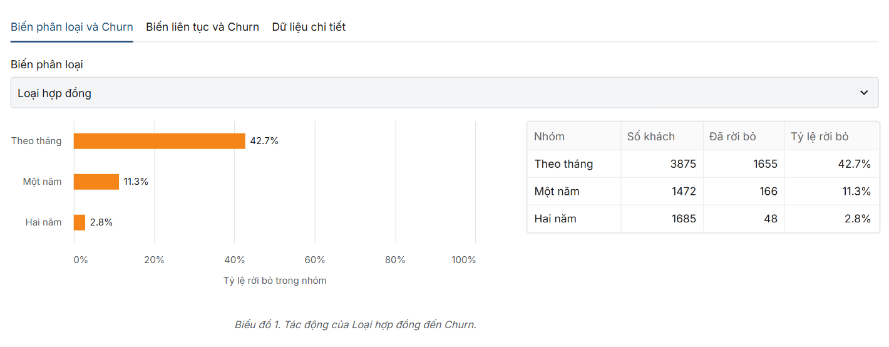

Dùng bảng thuộc tính ngắn ở bên trái và ảnh bên phải. Nhấn mạnh tỷ lệ Churn trong từng nhóm, không chỉ số lượng khách rời bỏ.

### Lời thoại

> Các thuộc tính được chia thành thông tin khách hàng, thời gian sử dụng, dịch vụ đăng ký, hợp đồng và chi phí. Trong dữ liệu sạch có 5.163 khách ở lại và 1.869 khách rời bỏ, tương ứng tỷ lệ Churn khoảng 26,58%. Đây là dữ liệu mất cân bằng vì nhóm ở lại chiếm đa số.
>
> Ở biểu đồ hợp đồng, nhóm theo tháng có 1.655 khách rời bỏ trên tổng 3.875 khách, tức khoảng 42,7%. Hai nhóm hợp đồng một năm và hai năm có tỷ lệ thấp hơn, lần lượt khoảng 11,3% và 2,8%.
>
> Đây là mối liên hệ quan sát trong dữ liệu. Nhóm chưa thực hiện thử nghiệm để kết luận rằng thay đổi loại hợp đồng sẽ trực tiếp làm giảm rời bỏ.

**Chuyển ý:** “Để đưa những thông tin này vào mô hình, nhóm thực hiện mã hóa và chia tập dữ liệu.”

## Slide 5 · Mã hóa đặc trưng và chia tập

**Thời lượng:** khoảng 1 phút 15 giây.

### Nội dung để chiếu

- Bỏ `customerID` và nhãn `Churn` khỏi đầu vào.
- Mã hóa `Churn`: **No = 0, Yes = 1**; các cột Yes/No chuyển thành 0/1.
- Gộp “No internet service”, “No phone service” về “No” ở các cột dịch vụ.
- One-hot encoding: **InternetService, Contract, PaymentMethod**.
- Khảo sát bằng ANOVA, Chi-square, Mutual Information và Spearman.
- Chia phân tầng **80/20**, seed **42** cho bài toán Churn.

| Tập | Ở lại | Rời bỏ | Tổng |
|---|---:|---:|---:|
| Train | 4.130 | 1.495 | 5.625 |
| Test | 1.033 | 374 | 1.407 |

### Ảnh và bố cục

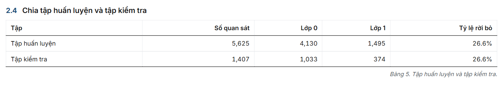

Đặt các bước mã hóa ở phía trên, ảnh chia tập phía dưới. Bảng trong ảnh và bảng văn bản cùng nội dung: khi dựng slide chỉ giữ một bản để tránh lặp.

### Lời thoại

> Mã khách hàng được giữ để đối chiếu nhưng không đưa vào mô hình. Nhãn Churn được tách riêng và mã hóa thành 0 hoặc 1. Các biến Yes/No được chuyển thành số; những biến nhiều giá trị như hợp đồng hay phương thức thanh toán được one-hot encoding.
>
> Nhóm có các phép khảo sát đặc trưng, nhưng bộ biến của từng mô hình hiện được khai báo sẵn theo báo cáo tham chiếu. Chương trình chưa tự động chọn biến bằng các kiểm định này trong từng fold.
>
> Với phân loại Churn, dữ liệu được chia phân tầng 80/20 và cố định seed 42. Tập huấn luyện có 5.625 khách; tập kiểm thử có 1.407 khách. Phần test được giữ riêng để đánh giá sau khi huấn luyện.

**Chuyển ý:** “Do lớp rời bỏ ít hơn, pipeline Logistic có thêm bước cân bằng dữ liệu.”

## Slide 6 · Cân bằng dữ liệu bằng SMOTE

**Thời lượng:** khoảng 55 giây.

### Nội dung để chiếu

- Logistic gốc sử dụng **SMOTE**, `k_neighbors=5`.
- Chỉ cân bằng phần huấn luyện; test giữ nguyên.
- SMOTE nằm trong pipeline và được fit lại bên trong mỗi fold CV.

| Train | Ở lại | Rời bỏ | Tổng |
|---|---:|---:|---:|
| Trước SMOTE | 4.130 | 1.495 | 5.625 |
| Sau SMOTE | 4.130 | 4.130 | 8.260 |

**Sinh thêm 2.635 mẫu lớp rời bỏ khi fit trên toàn bộ train.**

### Ảnh và bố cục

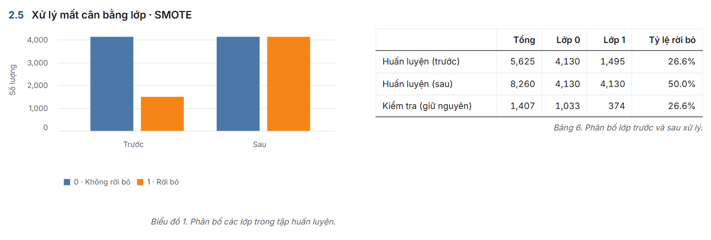

Để biểu đồ trước/sau chiếm phần lớn slide. Dùng một dòng nhấn mạnh “Chỉ trên Train”.

### Lời thoại

> SMOTE tạo thêm mẫu lớp thiểu số bằng cách nội suy giữa các mẫu hiện có. Khi áp dụng trên toàn bộ train gốc, số mẫu rời bỏ tăng từ 1.495 lên 4.130, bằng số mẫu ở lại.
>
> Bước này chỉ áp dụng cho dữ liệu học. Trong kiểm định chéo, SMOTE được fit bên trong từng fold để không dùng dữ liệu validation tạo mẫu cho phần học. Tập test vẫn giữ 1.407 hồ sơ với phân bố ban đầu.
>
> Decision Tree trong pipeline gốc không dùng SMOTE. Phần demo huấn luyện lại có thể cấu hình phương pháp cân bằng riêng cho từng mô hình phân loại.

**Chuyển ý:** “Sau cân bằng, Logistic tiếp tục chuẩn hóa các đặc trưng.”

## Slide 7 · Chuẩn hóa dữ liệu

**Thời lượng:** khoảng 45 giây.

### Nội dung để chiếu

**StandardScaler:** `z = (x − μ) / σ`

**Pipeline Logistic:**

**SMOTE → StandardScaler → Logistic Regression**

- Scaler chỉ fit trên phần học sau cân bằng.
- Dùng cùng scaler để biến đổi validation/test.
- Decision Tree không dùng StandardScaler.

### Ảnh và bố cục

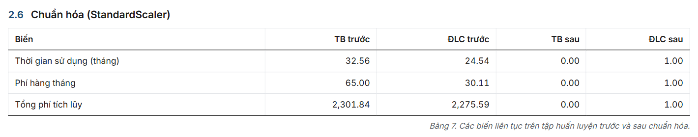

Đặt công thức và pipeline phía trên, bảng phía dưới. Thêm chú thích nhỏ: **“Bảng minh họa trên train gốc; scaler Logistic thực tế fit sau SMOTE.”**

### Lời thoại

> StandardScaler đưa các đặc trưng về thang đo chuẩn hóa dựa trên trung bình và độ lệch chuẩn của dữ liệu học. Trong pipeline Logistic, thứ tự thực tế là SMOTE, rồi StandardScaler, sau đó mới đến bộ phân loại.
>
> Bảng trên màn hình minh họa ba biến liên tục của train gốc. Bảng này dùng để giải thích nguyên lý, còn scaler của mô hình Logistic được fit sau SMOTE và áp dụng trên toàn bộ bộ đặc trưng đã chọn. Decision Tree không cần bước chuẩn hóa trong triển khai hiện tại.

**Chuyển ý:** “Từ dữ liệu đã chuẩn bị, nhóm triển khai các mô hình sau.”

## Slide 8 · Các mô hình đã triển khai

**Thời lượng:** khoảng 1 phút 25 giây.

### Nội dung để chiếu

| Mô hình | Mục tiêu | Cấu hình chính của pipeline gốc |
|---|---|---|
| Decision Tree | Phân loại Churn | Gini, độ sâu tối đa 4, 7 đặc trưng |
| Logistic Regression | Phân loại Churn | Bản đầy đủ 23 biến; bản điều chỉnh 16 biến |
| Linear Regression | Dự đoán MonthlyCharges | OLS đầy đủ và OLS điều chỉnh 10 biến |

**Logistic:** sigmoid chuyển tổ hợp tuyến tính thành điểm lớp rời bỏ; ngưỡng nhãn **0,5**.

**OLS điều chỉnh:** R² test **0,9689** · MAE **3,5306** · RMSE **5,2402**.

**Hai thuật toán phân loại Churn; hồi quy tuyến tính có mục tiêu riêng.**

### Ảnh và bố cục

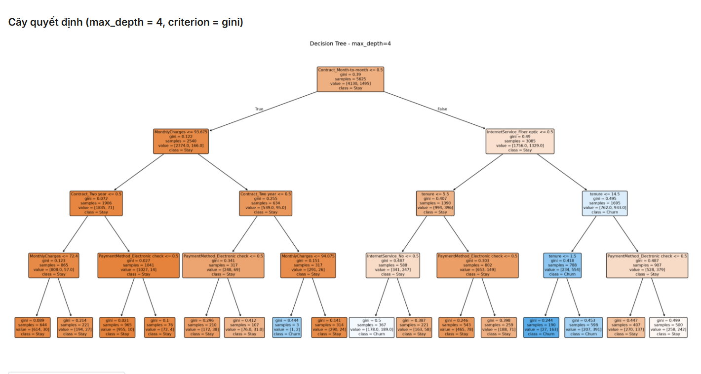

Đặt bảng mô hình bên trái. Bên phải chỉ phóng to phần gốc và vài nhánh đầu của cây; không bắt người xem đọc toàn bộ chữ trong cây. Giữ kết quả OLS ở một dải ngắn phía dưới, ghi rõ mục tiêu MonthlyCharges.

### Lời thoại

> Nhóm triển khai ba họ mô hình, nhưng cần phân biệt mục tiêu. Decision Tree và Logistic Regression dùng để phân loại Churn. Tree có độ sâu tối đa 4 và sử dụng bảy đặc trưng, giúp quan sát các quy tắc chia nhóm khách hàng.
>
> Logistic được chạy với hai bộ biến: bản đầy đủ có 23 đặc trưng và bản điều chỉnh có 16 đặc trưng. Cấu hình điều chỉnh được lưu làm mô hình dự đoán mặc định, với ngưỡng nhãn là 0,5.
>
> Linear Regression trong code hiện tại dự đoán phí hàng tháng, không dự đoán Churn. Bản OLS điều chỉnh đạt R² test khoảng 0,9689. Đây là kết quả hồi quy phí, nên không so trực tiếp R² với F1 hay AUC của mô hình phân loại. Như vậy, bảng so sánh Churn phía sau gồm Tree và hai cấu hình Logistic.

**Chuyển ý:** “Nhóm đánh giá các mô hình theo quy trình huấn luyện và các độ đo sau.”

## Slide 9 · Huấn luyện và độ đo đánh giá

**Thời lượng:** khoảng 1 phút 10 giây.

### Nội dung để chiếu

**Quy trình Logistic gốc**

**Train 80% → CV phân tầng 5 fold → Fit toàn bộ Train → Đánh giá Test 20%**

- CV gốc tính **Recall và Accuracy** cho hai cấu hình Logistic.
- Recall CV: **đầy đủ 79,46% · điều chỉnh 77,53%**.
- Test: Precision, Recall, F1 lớp rời bỏ, ROC-AUC và Accuracy.

| Chỉ số | Ý nghĩa ngắn |
|---|---|
| Precision | Tỷ lệ cảnh báo đúng trong số khách được cảnh báo |
| Recall | Tỷ lệ phát hiện trong số khách thực sự rời bỏ |
| F1 lớp 1 | Cân bằng Precision và Recall |
| ROC-AUC | Khả năng phân biệt hai lớp qua điểm xếp hạng |

### Ảnh và bố cục

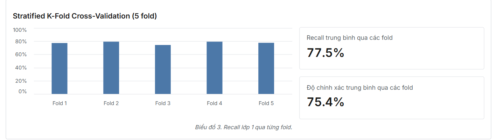

Đặt ảnh cạnh bảng ý nghĩa độ đo. Chú thích: **“Logistic điều chỉnh: Recall CV ≈ 77,5%; không phải Recall test.”**

### Lời thoại

> Với Logistic, nhóm sử dụng kiểm định chéo phân tầng năm fold trên tập train. Toàn bộ pipeline, gồm cả SMOTE và scaler, được fit lại trong từng fold. Sau bước CV, mô hình được fit trên toàn bộ train và đánh giá trên test.
>
> Recall CV trung bình của bản đầy đủ khoảng 79,46%, bản điều chỉnh khoảng 77,53%. Tree trong pipeline gốc chưa chạy CV; phần demo huấn luyện lại có CV Recall cho cả Tree và Logistic.
>
> Trên test, nhóm xem Precision, Recall, F1 và ROC-AUC. Theo mục tiêu đề tài, F1 lớp rời bỏ là tiêu chí đáng chú ý. Tuy nhiên, code hiện chưa chọn mô hình bằng F1 CV rồi mới mở test; F1 được trình bày sau đây là F1 trên tập kiểm thử.

**Chuyển ý:** “Sau đây là kết quả thực tế đã lưu của các cấu hình phân loại.”

## Slide 10 · So sánh kết quả phân loại

**Thời lượng:** khoảng 1 phút 15 giây.

### Nội dung để chiếu

**Cùng tập kiểm thử 1.407 khách hàng · Lớp dương là khách rời bỏ**

| Cấu hình | Accuracy | Precision | Recall | F1 | ROC-AUC |
|---|---:|---:|---:|---:|---:|
| Decision Tree | 0,7825 | 0,6133 | 0,4920 | 0,5460 | 0,8214 |
| Logistic đầy đủ | 0,7306 | 0,4958 | 0,7807 | 0,6064 | 0,8336 |
| Logistic điều chỉnh | 0,7385 | 0,5053 | 0,7620 | 0,6077 | 0,8273 |

- Tree: Accuracy và Precision cao hơn, nhưng bỏ sót nhiều hơn.
- Logistic đầy đủ: Recall và AUC cao nhất trong ba cấu hình.
- Logistic điều chỉnh: F1 test nhỉnh hơn, dùng ít biến hơn.

### Ảnh và bố cục

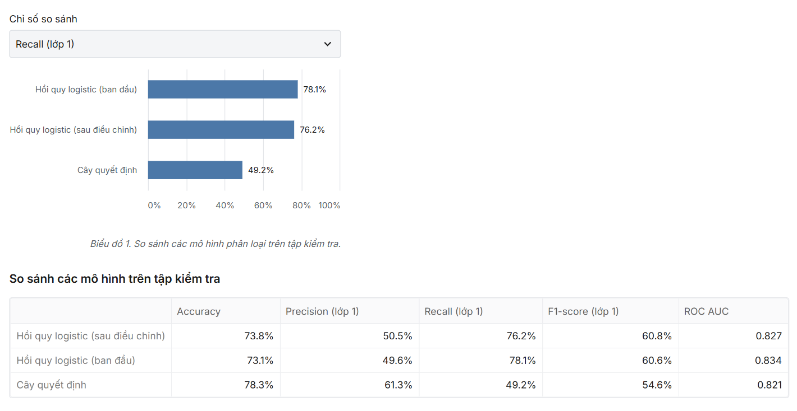

Ưu tiên dựng bảng số liệu dạng chữ để dễ đọc. Có thể cắt riêng biểu đồ Recall trong ảnh để đặt bên cạnh; biểu đồ ảnh đang thể hiện Recall, không đổi nhãn thành F1.

### Lời thoại

> Bảng này so sánh trên cùng 1.407 khách kiểm thử. Decision Tree có Accuracy khoảng 78,25% và Precision khoảng 61,33%, nhưng Recall chỉ khoảng 49,20%, nghĩa là chưa tìm được một nửa số khách thực sự rời bỏ.
>
> Hai cấu hình Logistic có Recall cao hơn. Bản đầy đủ đạt Recall khoảng 78,07% và AUC 0,8336. Bản điều chỉnh đạt F1 khoảng 0,6077, nhỉnh hơn bản đầy đủ và sử dụng ít đặc trưng hơn.
>
> Chênh lệch F1 giữa hai bản Logistic rất nhỏ, nên nhóm không kết luận bản điều chỉnh vượt trội ổn định. Đây là so sánh từ kết quả test đang lưu; mô hình mặc định hiện được code lưu sẵn là Logistic điều chỉnh.

**Chuyển ý:** “Để thấy rõ đánh đổi giữa phát hiện và cảnh báo nhầm, nhóm phân tích ma trận của bản điều chỉnh.”

## Slide 11 · Phân tích ma trận nhầm lẫn

**Thời lượng:** khoảng 1 phút.

### Nội dung để chiếu

**LOGISTIC REGRESSION ĐIỀU CHỈNH**

| Thực tế / Dự đoán | Ở lại | Rời bỏ |
|---|---:|---:|
| Ở lại | **754** đúng | **279** cảnh báo nhầm |
| Rời bỏ | **89** bỏ sót | **285** phát hiện đúng |

- Recall: **285/374 ≈ 76,20%**.
- Precision: **285/564 ≈ 50,53%**.
- Bỏ sót: mất cơ hội chăm sóc; cảnh báo nhầm: tốn nguồn lực rà soát.

### Ảnh và bố cục

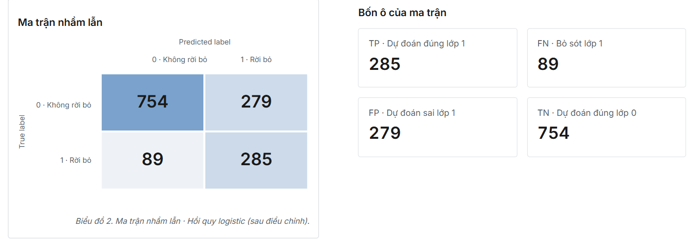

Dùng ảnh làm hình chính và hai thẻ Recall/Precision ở dưới. Bảng văn bản là phương án dựng lại, không cần hiển thị trùng với ảnh.

### Lời thoại

> Trong 374 khách thực sự rời bỏ, Logistic điều chỉnh phát hiện đúng 285 khách và bỏ sót 89 khách, tương ứng Recall khoảng 76,20%.
>
> Ở chiều cảnh báo, mô hình đưa ra tổng cộng 564 cảnh báo, gồm 285 trường hợp đúng và 279 trường hợp nhầm. Vì vậy Precision khoảng 50,53%.
>
> Kết quả cho thấy điểm nguy cơ có thể hỗ trợ sàng lọc, nhưng danh sách cảnh báo vẫn cần được rà soát. Doanh nghiệp phải cân nhắc cả chi phí bỏ sót khách lẫn chi phí chăm sóc những khách vốn chưa rời bỏ.

**Chuyển ý:** “Ngoài độ chính xác, nhóm cũng xem các yếu tố đang ảnh hưởng đến điểm dự đoán.”

## Slide 12 · Giải thích hệ số và điểm nguy cơ

**Thời lượng:** khoảng 55 giây.

### Nội dung để chiếu

**Hệ số Logistic điều chỉnh sau chuẩn hóa**

| Đặc trưng | Hệ số |
|---|---:|
| Internet cáp quang | +0,5681 |
| Hợp đồng theo tháng | +0,3960 |
| Thời gian sử dụng | −0,5566 |
| Bảo mật trực tuyến | −0,2538 |
| Hợp đồng hai năm | −0,2262 |

- Dấu hệ số thể hiện chiều thay đổi **log-odds dự đoán**, khi giữ các biến khác cố định.
- Điểm nguy cơ **chưa được hiệu chuẩn thành xác suất thực tế**.

### Ảnh và bố cục

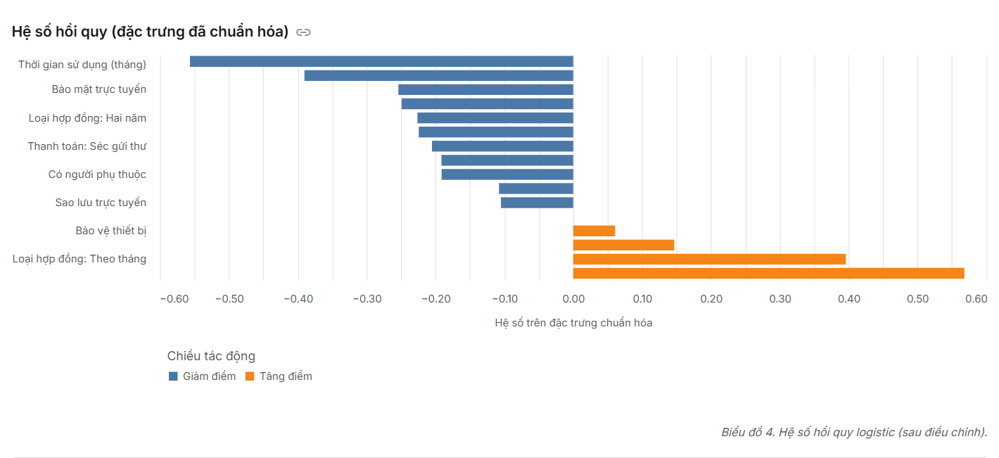

Đặt biểu đồ làm hình chính, bên cạnh chỉ giữ hai gạch đầu dòng giải thích. Bảng năm hệ số dùng khi cần dựng biểu đồ mới hoặc đọc số; không cần chiếu cả hai.

### Lời thoại

> Trong mô hình Logistic điều chỉnh, Internet cáp quang và hợp đồng theo tháng có hệ số dương; thời gian sử dụng, bảo mật trực tuyến và hợp đồng hai năm có hệ số âm.
>
> Các dấu này mô tả chiều liên hệ trong mô hình khi giữ các biến còn lại cố định. Chúng không phải mức tăng giảm xác suất theo phần trăm và cũng không chứng minh quan hệ nhân quả.
>
> Điểm trả về từ mô hình chưa được hiệu chuẩn, đặc biệt vì SMOTE làm thay đổi tỷ lệ lớp lúc học. Vì vậy, nhóm sử dụng điểm để hỗ trợ xếp ưu tiên, chưa khẳng định một khách có điểm 0,8 thì xác suất rời bỏ thực tế chính xác là 80%.

**Chuyển ý:** “Nhóm cũng triển khai quy trình bổ sung dữ liệu và huấn luyện lại theo đợt.”

## Slide 13 · Cập nhật dữ liệu và huấn luyện lại

**Thời lượng:** khoảng 1 phút 10 giây.

### Nội dung để chiếu

**Dữ liệu → Tiền xử lý → Huấn luyện → So sánh → Chọn mô hình dự đoán**

- Nạp CSV mới **đủ 21 cột, có nhãn Churn thực tế**.
- Mã khách trùng: ưu tiên bản ghi mới.
- Cấu hình thuật toán, bộ biến và cách cân bằng lớp.
- Lưu mô hình, cấu hình và kết quả theo từng lần chạy.
- So sánh theo Recall, Precision, F1, ROC-AUC hoặc Accuracy; bấm chọn mô hình dùng dự đoán.

**Hiện khởi chạy bằng thao tác người dùng; chưa có lịch tự động hàng tháng.**

### Ảnh và bố cục

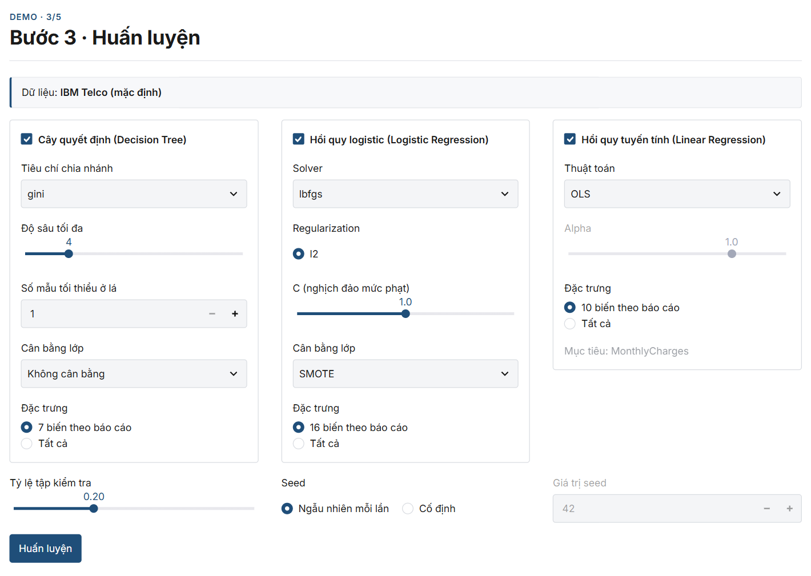

Đặt ảnh bên phải, quy trình năm bước và các ý chính bên trái. Ảnh thể hiện khả năng cấu hình, không phải kết quả một lần huấn luyện mới. Không chèn chỉ số cải thiện sau huấn luyện lại khi chưa có kết quả thực tế.

### Lời thoại

> Người dùng có thể nạp CSV mới đã có nhãn Churn thực tế để kết hợp với dữ liệu ban đầu. Khi trùng mã khách hàng, bản ghi mới được ưu tiên. Sau đó hệ thống làm sạch, mã hóa, chia tập và huấn luyện theo cấu hình đã chọn.
>
> Mỗi lần chạy được lưu riêng, gồm cấu hình, chỉ số và tệp mô hình. Trang So sánh cho xem kết quả theo nhiều tiêu chí, trong đó có F1, rồi người dùng bấm chọn classifier sẽ dùng cho dự đoán.
>
> Đây là huấn luyện lại theo đợt bằng thao tác người dùng. Chương trình chưa có lịch tự chạy hàng tháng và chưa có màn hình cập nhật nhãn từng hồ sơ. Nhãn thực tế hiện được chuẩn bị trong CSV; form dự đoán không tự trở thành dữ liệu học mới.

**Chuyển ý:** “Sau đây nhóm minh họa cách xem dữ liệu và sử dụng chức năng dự đoán.”

## Slide 14 · Demo ứng dụng Streamlit

**Thời lượng:** khoảng 2 phút, gồm thao tác trực tiếp.

### Nội dung để chiếu

**HAI CÁCH NHẬP HỒ SƠ**

- Nhập một khách hàng bằng form.
- Tải CSV để dự đoán hàng loạt.

**KẾT QUẢ**

- Điểm nguy cơ, nhãn Churn và nhóm rủi ro.
- Lọc, sắp xếp danh sách và tải CSV kết quả.
- Nhãn rời bỏ khi điểm **≥ 0,5**.

**Nhóm rủi ro minh họa:** Thấp **≤ 0,3** · Trung bình **> 0,3 đến 0,6** · Cao **> 0,6**.

### Ảnh và bố cục

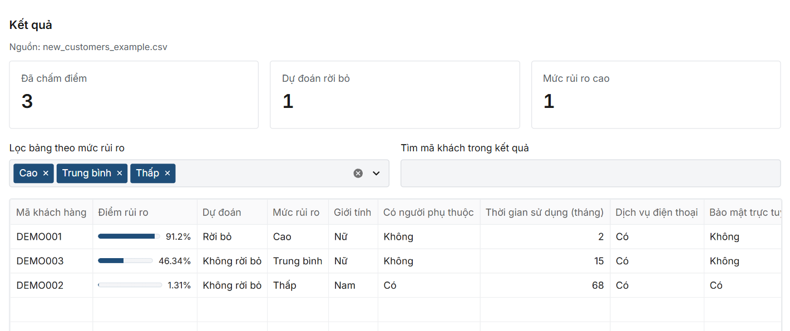

Chiếu ảnh để giới thiệu, sau đó chuyển sang ứng dụng thật. Giữ ảnh làm phương án trình bày nếu ứng dụng không mở được; khi dùng ảnh, nói rõ đây là kết quả đã chụp, không mô tả như đang chạy trực tiếp.

### Chuẩn bị trước khi báo cáo

- Mở sẵn ứng dụng, kiểm tra các trang đọc được dữ liệu và mô hình.
- Để tái hiện ảnh gốc, dùng Logistic điều chỉnh mặc định; nếu đang kích hoạt mô hình khác, giải thích đúng mô hình hiện hành.
- Kiểm tra nút “Chạy thử 3 khách hàng mẫu” và tải CSV hoạt động trước buổi báo cáo.
- Chuẩn bị `data/new_customers_example.csv`; không lấy nhãn dự đoán làm nhãn thực tế.
- Nếu form báo thiếu trường sau khi chọn cấu hình nhiều biến, dùng CSV đủ trường mà mô hình yêu cầu. Form hiện không có đủ đầu vào cho mọi cấu hình.

### Trình tự thao tác và lời thoại

| Thời gian | Thao tác | Lời thoại |
|---|---|---|
| 0:00–0:20 | Mở “Mô tả dữ liệu” | “Ứng dụng hiển thị 7.032 hồ sơ hợp lệ sau khi loại 11 dòng thiếu tổng phí. Từ menu, người dùng có thể xem dữ liệu, kết quả mô hình hoặc chuyển sang quy trình demo.” |
| 0:20–0:45 | Mở “5. Dự đoán”, chọn “Hàng loạt qua CSV”, bấm “Chạy thử 3 khách hàng mẫu” | “Ở đây nhóm dùng ba hồ sơ mẫu để minh họa. Với dữ liệu riêng, người dùng có thể tải CSV theo các trường mà mô hình hiện tại yêu cầu.” |
| 0:45–1:15 | Chỉ vào điểm, nhãn và nhóm rủi ro | “Mỗi dòng nhận một điểm nguy cơ, nhãn dự đoán và nhóm rủi ro. Danh sách được xếp theo điểm để hỗ trợ xác định hồ sơ cần xem trước. Đây là điểm mô hình, chưa phải xác suất đã hiệu chuẩn.” |
| 1:15–1:35 | Lọc nhóm cao, sau đó tải kết quả CSV | “Người dùng có thể lọc nhóm cần quan tâm và tải toàn bộ kết quả CSV. Ngưỡng nhóm nguy cơ là các mốc minh họa; nhãn phân loại dùng riêng ngưỡng 0,5.” |
| 1:35–2:00 | Chuyển sang “Một khách hàng”, chọn hồ sơ mẫu và bấm dự đoán | “Ngoài chấm điểm hàng loạt, ứng dụng có form cho một khách. Kết quả có thể tải về, nhưng hồ sơ này chưa tự được lưu vào tập huấn luyện. Muốn huấn luyện lại, cần chuẩn bị dữ liệu có nhãn thực tế.” |

**Lời thoại khi dùng ảnh thay demo trực tiếp**

> Ảnh này ghi lại kết quả ba khách mẫu ở lần chạy trước. Người dùng có thể xem điểm, lọc nhóm rủi ro và tải CSV. Các con số phụ thuộc vào mô hình đang được chọn; chức năng không tự lưu hồ sơ dự đoán làm dữ liệu huấn luyện.

**Chuyển ý:** “Từ phần thực nghiệm và demo, nhóm xin tổng kết những kết quả đã đạt được.”

## Slide 15 · Kết luận và hướng hoàn thiện

**Thời lượng:** khoảng 55 giây.

### Nội dung để chiếu

**ĐÃ THỰC HIỆN**

- Làm sạch, khám phá và mã hóa dữ liệu IBM Telco.
- Tree và Logistic phân loại Churn; Linear Regression phân tích phí.
- Streamlit hỗ trợ dự đoán một khách/CSV và huấn luyện lại theo đợt.

**KẾT QUẢ LOGISTIC ĐIỀU CHỈNH**

**F1 = 0,6077 · Recall = 76,20% · Phát hiện 285/374 khách rời bỏ**

**HƯỚNG HOÀN THIỆN**

- Chọn mô hình bằng F1 CV trước lần kiểm thử cuối cùng.
- Lưu hồ sơ, cập nhật nhãn thật và lập lịch huấn luyện tháng.
- Hiệu chuẩn điểm, đánh giá dữ liệu mới và chọn ngưỡng phù hợp.

**CẢM ƠN THẦY CÔ VÀ CÁC BẠN ĐÃ LẮNG NGHE**

### Ảnh và bố cục

Không cần ảnh. Dùng ba thẻ số F1, Recall, số khách phát hiện đúng ở trung tâm; hai cột “Đã thực hiện” và “Hướng hoàn thiện” ở hai bên. Giữ lời cảm ơn nhỏ phía cuối.

### Lời thoại

> Nhóm đã triển khai quy trình từ làm sạch dữ liệu đến huấn luyện, đánh giá và xây dựng ứng dụng dự đoán. Logistic điều chỉnh đạt F1 test khoảng 0,6077 và phát hiện 285 trên 374 khách rời bỏ, nhưng vẫn có 89 khách bị bỏ sót và 279 cảnh báo nhầm.
>
> Vì vậy, kết quả hiện phù hợp để minh họa hỗ trợ ưu tiên rà soát. Những phần cần hoàn thiện gồm chọn mô hình bằng F1 trên kiểm định chéo, lưu hồ sơ và nhãn thực tế, lập lịch huấn luyện và hiệu chuẩn điểm trên dữ liệu mới.
>
> Phần trình bày của nhóm em đến đây là kết thúc. Nhóm em cảm ơn thầy cô và các bạn, và xin tiếp nhận câu hỏi.

## Ghi chú phản biện cho người trình bày

Phần này là ghi chú dự phòng, không tính thêm slide.

| Câu hỏi | Cách trả lời ngắn |
|---|---|
| Có ba thuật toán cùng dự đoán Churn không? | Hiện chỉ Tree và Logistic phân loại Churn. Linear Regression có mục tiêu MonthlyCharges, cần trình bày riêng. |
| Vì sao không chọn Tree có Accuracy cao hơn? | Tree phát hiện 184/374 khách rời bỏ; Logistic điều chỉnh phát hiện 285/374, nhưng có nhiều cảnh báo nhầm hơn. |
| Có chọn mô hình bằng F1 CV chưa? | Chưa. CV gốc dùng Recall và Accuracy cho Logistic; F1 hiện tính trên test. Trang So sánh có thể xếp theo F1 test đã lưu. |
| Vì sao Logistic điều chỉnh là mặc định? | Code lưu sẵn cấu hình này làm mô hình mặc định. Nó có F1 test nhỉnh hơn và ít biến hơn; chưa có bộ chọn tự động theo F1 CV. |
| Có tự chạy lại mỗi tháng không? | Chưa. Người dùng nạp CSV có nhãn và bấm huấn luyện theo đợt. |
| Hồ sơ nhập vào có tự lưu để học thêm không? | Chưa có kho hồ sơ dự đoán lưu bền vững. Có tải CSV kết quả; huấn luyện lại cần dữ liệu đầy đủ và nhãn thật. |
| Điểm 0,55 vì sao dự đoán rời bỏ nhưng nhóm trung bình? | Nhãn dùng mốc 0,5; nhóm nguy cơ dùng mốc 0,3 và 0,6. Hai đầu ra có cách chia khác nhau. |
| Điểm 0,8 có phải xác suất thực tế 80% không? | Chưa thể khẳng định vì mô hình chưa được hiệu chuẩn. |
| Có tự tìm 16 đặc trưng tốt nhất không? | Không. Bộ 16 biến khai báo sẵn theo báo cáo tham chiếu; các kiểm định dùng khảo sát dữ liệu. |
| Form có dùng phí hàng tháng không? | Form có trường phí; Logistic điều chỉnh mặc định không dùng cột phí trong bộ biến của nó. Tree gốc có MonthlyCharges. |
| Đã chứng minh giảm tỷ lệ rời bỏ chưa? | Chưa có thử nghiệm can thiệp hoặc đo hiệu quả kinh doanh. Ứng dụng hiện hỗ trợ xếp ưu tiên hồ sơ. |

## Nguồn đối chiếu khi cập nhật kịch bản

- Số liệu chất lượng và kết quả mô hình: [outputs/metrics.json](../../outputs/metrics.json).
- Đọc, làm sạch, mã hóa và chuẩn bị dữ liệu dự đoán: [src/data.py](../../src/data.py).
- Bộ đặc trưng: [src/schema.py](../../src/schema.py).
- Huấn luyện gốc, CV, OLS và Logistic: [src/models.py](../../src/models.py).
- Huấn luyện lại, lưu lần chạy và kích hoạt mô hình: [src/retrain.py](../../src/retrain.py).
- Giao diện và kiểm tra dữ liệu đầu vào: [app.py](../../app.py), [src/dashboard.py](../../src/dashboard.py).
- Điểm nguy cơ, ngưỡng và nhóm rủi ro: [predict.py](../../predict.py).

Khi chạy lại pipeline hoặc thay mô hình đang sử dụng, cần đối chiếu lại số liệu và ảnh trước buổi báo cáo. Bảng kết quả trong kịch bản này mô tả artifacts gốc đang lưu, không phải kết quả của một lần huấn luyện mới.
